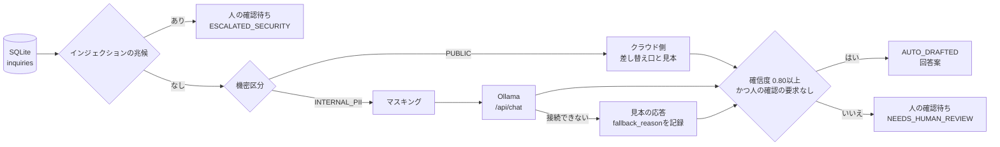

# fde-hybrid-router：機密区分で問い合わせをクラウド側とローカルLLMに振り分けるルーター

[](https://github.com/takashi-101/fde-hybrid-router/actions/workflows/tests.yml)

問い合わせの本文を、個人情報の有無とプロンプトインジェクション（LLMへの指示の上書きを狙う入力）の兆候で判定し、公開情報はクラウド側へ、個人情報・内部情報はマスキング（伏せ字に置き換えること）してローカルLLMへ、兆候のある入力は人の確認へ振り分けます。結果はSQLite（ファイル1つで動くデータベース）に記録します。標準ライブラリだけで動きます。

## 30秒で読む要点
- **ローカルLLMは実際に呼びます**：個人情報・内部情報を含む問い合わせは、氏名・電話番号などをマスキングしたうえで、Ollama（手元のPCでLLMを動かすソフト）の `/api/chat` にHTTPで送ります。temperature 0（応答のばらつきを抑える設定）、既定のモデルは `qwen2.5:7b` です。
- **クラウド側は差し替え口と見本**です。有料APIは呼ばず、固定の応答を返す見本 `sample_cloud_backend` が入っています。公開情報と判定した問い合わせだけが、ここに渡ります。
- **実際に答えたものを記録します**：Ollamaに接続できないとき（GitHubでの自動テストを含む）は見本の応答に切り替え、答えたバックエンド（`answered_by`）と切り替えた理由（`fallback_reason`）を、結果とSQLiteに残します。
- **接続先の制限と人の確認**：接続先は許可リスト（接続してよいホストの一覧。127.0.0.1、localhost、::1）に限り、リダイレクト（別のURLへの転送）は追いません。プロンプトインジェクションの兆候があればどのLLMにも渡さず、確信度（回答案の確からしさを0〜1で表した値）が0.80未満の案件、LLMが人の確認を求めた案件とともに、人の確認待ちの表（`human_review_queue`）に入れます。

## 何が実装で、何が見本か
| 部分 | 状態 | 場所 |
|---|---|---|
| 機密区分の判定とマスキング | 実装（正規表現（文字列のパターン）とキーワード） | `src/hybrid_router/guard.py` |
| プロンプトインジェクションの検知 | 実装（正規表現4種） | `src/hybrid_router/guard.py` |
| ローカルLLMの呼び出し | 実装（Ollama `/api/chat`、urllib、許可リスト、リダイレクトを追わない） | `src/hybrid_router/backends.py` の `OllamaLocalBackend` |
| クラウドLLM | **差し替え口と見本**（固定の応答。外部への通信なし） | `src/hybrid_router/backends.py` の `sample_cloud_backend` |
| Ollamaに接続できないときの応答 | 見本（固定の応答） | `src/hybrid_router/backends.py` の `sample_local_backend` |
| DB連携と人の確認待ちの表 | 実装（SQLite） | `src/hybrid_router/db.py` |

## 処理の流れ


## 確信度の決め方
LLM経路の確信度は、モデルがJSONで返す自己申告の値（0〜1に収める）をそのまま使い、較正（実際の正答率との突き合わせ）はしていません。JSONとして読めない応答は0.0として人の確認に回します。

見本（`sample_cloud_backend`、`sample_local_backend`）の確信度は、コードに書いた固定の値（0.92、0.86、0.68、0.55、0.42）で、測った値ではありません。

## 実行
前提：Ollamaが `http://127.0.0.1:11434` で動いていて、`qwen2.5:7b` が入っていること（`ollama list` で確認できます）。Ollamaが無くても、見本の応答に切り替えて最後まで動きます。

```
python -m unittest discover -s tests -v
python run_demo.py
python run_demo.py --ollama-url http://127.0.0.1:9
```
- 1行目：テスト（Ollamaは不要です）。
- 2行目：架空の問い合わせ4件を処理し、SQLiteに記録した内容を表示します。DBは一時ファイルで、終了時に消します。残す場合は `--db ファイル名` を付けます。
- 3行目：何も動いていないポートを指定し、Ollamaに接続できないときの動きを確かめます。

| オプション | 既定値 | 内容 |
|---|---|---|
| `--ollama-url` | 環境変数 `HYBRID_ROUTER_OLLAMA_URL`、無ければ `http://127.0.0.1:11434` | Ollamaの接続先 |
| `--model` | 環境変数 `HYBRID_ROUTER_MODEL`、無ければ `qwen2.5:7b` | モデル名 |
| `--timeout` | 120 | Ollamaの応答を待つ秒数 |
| `--db` | なし（一時ファイル） | 残すSQLiteファイル |

許可するホストは環境変数 `HYBRID_ROUTER_LLM_ALLOWED_HOSTS`（カンマ区切り、既定 `127.0.0.1,localhost,::1`）で変えられます。許可リストに無い接続先を指定すると、何も送らずに終了します（終了コード2）。

### 実行結果（Ollamaあり）
2026-11-14、Windows 11、Python 3.14、Ollama 0.40.16、`qwen2.5:7b` で `python run_demo.py` を実行した出力です。

```
{
  "local_llm": {
    "url": "http://127.0.0.1:11434",
    "model": "qwen2.5:7b"
  },
  "processed": 4,
  "routing_results": [
    {
      "ticket_id": "T-001",
      "data_classification": "PUBLIC",
      "route_target": "CLOUD_LLM",
      "review_status": "AUTO_DRAFTED",
      "confidence": 0.92,
      "escalation_reason": "",
      "sanitized_payload": "図書館の営業時間とアクセス方法（一般公開情報）を教えてください。",
      "draft_answer": "【見本・公開案内】施設案内に関する一般的なご案内です。",
      "answered_by": "sample_cloud",
      "fallback_reason": ""
    },
    {
      "ticket_id": "T-002",
      "data_classification": "INTERNAL_PII",
      "route_target": "LOCAL_LLM_MASKED",
      "review_status": "AUTO_DRAFTED",
      "confidence": 0.9,
      "escalation_reason": "",
      "sanitized_payload": "氏名：[PERSON_MASKED] / 連絡先：[PHONE_MASKED] / 支給要件の標準手順を確認したい。",
      "draft_answer": "給付金の支給要件の標準手順は、申請時期、所得状況、居住期間などに基づいています。詳しくは、給付金の詳細ページをご覧ください。",
      "answered_by": "ollama:qwen2.5:7b",
      "fallback_reason": ""
    },
    {
      "ticket_id": "T-003",
      "data_classification": "INTERNAL_PII",
      "route_target": "LOCAL_LLM_MASKED",
      "review_status": "NEEDS_HUMAN_REVIEW",
      "confidence": 0.8,
      "escalation_reason": "High-risk case flagged by ollama:qwen2.5:7b",
      "sanitized_payload": "氏名：[PERSON_MASKED] / 個人番号：[ID_NUM_MASKED] / 決定に対する不服申立と例外対応を希望。",
      "draft_answer": "[PERSON_MASKED] 様、ご連絡ありがとうございます。不服申立とご希望に沿った対応をさせていただきます。詳細な内容をご提供いただけますと幸いです。",
      "answered_by": "ollama:qwen2.5:7b",
      "fallback_reason": ""
    },
    {
      "ticket_id": "T-004",
      "data_classification": "PUBLIC",
      "route_target": "BLOCKED_HUMAN_ONLY",
      "review_status": "ESCALATED_SECURITY",
      "confidence": 0.0,
      "escalation_reason": "Prompt injection detected: jp_override, jp_role_hijack",
      "sanitized_payload": "[BLOCKED_BY_INJECTION_GUARD]",
      "draft_answer": "",
      "answered_by": "none",
      "fallback_reason": ""
    }
  ],
  "human_review_queue": [
    {
      "ticket_id": "T-003",
      "review_status": "NEEDS_HUMAN_REVIEW",
      "reason": "High-risk case flagged by ollama:qwen2.5:7b",
      "confidence": 0.8,
      "resolved": 0
    },
    {
      "ticket_id": "T-004",
      "review_status": "ESCALATED_SECURITY",
      "reason": "Prompt injection detected: jp_override, jp_role_hijack",
      "confidence": 0.0,
      "resolved": 0
    }
  ]
}
```
- `sanitized_payload` が、ローカルLLMに実際に送った本文です。氏名・電話番号・個人番号は伏せ字になっています。
- T-002の回答案は、参照資料なしにモデルが書いたものです。内容の正しさは確かめていません。
- T-003は、モデルが `needs_human` を true で返したため、人の確認待ちに入りました。
- temperature 0でも、応答は実行ごとに変わることがあります。手元で同じ入力を2回処理したとき、T-002の確信度は0.95と0.9で、回答文も違いました。

### 実行結果（Ollamaなし）
`python run_demo.py --ollama-url http://127.0.0.1:9` の出力の一部です。

```
{
  "local_llm": {
    "url": "http://127.0.0.1:9",
    "model": "qwen2.5:7b"
  },
  "processed": 4,
  "routing_results": [
…（省略）
    {
      "ticket_id": "T-002",
      "data_classification": "INTERNAL_PII",
      "route_target": "LOCAL_LLM_MASKED",
      "review_status": "AUTO_DRAFTED",
      "confidence": 0.86,
      "escalation_reason": "",
      "sanitized_payload": "氏名：[PERSON_MASKED] / 連絡先：[PHONE_MASKED] / 支給要件の標準手順を確認したい。",
      "draft_answer": "【見本・ローカル】給付金の標準手順に基づく一次回答候補です。",
      "answered_by": "sample_local",
      "fallback_reason": "local LLM unavailable: cannot reach http://127.0.0.1:9/api/chat: [WinError 10061] 対象のコンピューターによって拒否されたため、接続できませんでした。"
    },
…（省略）
```
答えたのが見本（`sample_local`）であることと、その理由が記録されます。CI（GitHubでの自動テスト）でも同じ経路で動きます。

## クラウド側の差し替え方
`(区分, マスキング後の本文) -> ModelPrediction` の形の関数なら、何でも差し込めます。

```python
from hybrid_router import HybridFDERouter, InquiryRepository, ModelPrediction

def my_cloud_backend(category_hint: str, sanitized_text: str) -> ModelPrediction:
    # ここで、利用を認められたクラウドLLMを呼ぶ
    return ModelPrediction("回答案", confidence=0.9, answered_by="my-cloud")

router = HybridFDERouter(InquiryRepository("inquiries.db"), cloud_backend=my_cloud_backend)
```
ルーターは、公開情報（`PUBLIC`）と判定した本文だけをクラウド側に渡します。

## テスト（16件）
- 振り分け：公開情報はクラウド側だけに渡ること、個人情報を含む本文はクラウド側に渡らずマスキングしてローカル側に渡ること、インジェクションはどちらのLLMにも渡らないこと、確信度が低い案件が人の確認待ちに入ること、再処理で自動回答になった案件が確認待ちから外れること。
- ローカルLLM（Ollamaは使わず、127.0.0.1上の代役のHTTPサーバーか、何も動いていないポートで確かめます）：許可リストに無いホスト・http(s)以外の接続先を拒否すること、環境変数で指定した接続先も同じく拒否すること、HTTPで実際に送った本文に氏名・電話番号が含まれないこと、リダイレクトを追わないこと、接続できないときに見本へ切り替えて `answered_by` と `fallback_reason` をDBに残すこと、確信度の扱い（範囲外は0〜1に収める、読めない応答は0.0）。

## 外部からの評価
[fde-eval-harness](https://github.com/takashi-101/fde-eval-harness) で、このリポジトリ（コミット `e93f42f`）を評価対象にして、架空の問い合わせ13件を `qwen2.5:7b` で処理し、振り分け・マスキング・遮断・人の確認を検査しました。結果は合格11件、既知の不合格2件（下の「制約」の1つ目と2つ目）、不合格0件です。詳細は fde-eval-harness の RESULTS.md にあります。

## 制約
- 機密区分の判定は正規表現とキーワードによるもので、「氏名：」の後の名前、電話番号、メールアドレス、12桁の番号、金額の書式しか検出しません。文中に紛れた氏名や住所は検出できません。
- インジェクションの検知は4つの正規表現で、言い換えには対応していません。
- 区分（`category_hint`）は判定とマスキングの対象外で、そのままLLMに渡ります。
- ローカルLLMの回答案は参照資料を使わずに作っており、内容の正しさは検証していません。確信度は較正していません。

## ファイル構成
```
src/hybrid_router/
  guard.py      機密区分の判定、マスキング、インジェクションの検知
  backends.py   Ollamaクライアント（許可リスト、リダイレクトを追わない）、見本、切り替え
  router.py     振り分けと人の確認（Human-in-the-Loop）
  db.py         SQLite（inquiries / routing_results / human_review_queue）
  cli.py        デモ
run_demo.py     インストールせずにデモを動かす入口
tests/          ユニットテスト
```
見本データ（氏名・電話番号・個人番号）はすべて架空です。

## 根拠（学習）

| 機能 | 裏付けになる学習（発行元・名称・発行日） | 照会先（Credly） |
|---|---|---|
| ローカルLLM（Ollama）の呼び出しと、接続先の許可リスト | Coursera（認定：IBM）「Building Generative AI-Powered Applications with Python」2026年11月9日 | https://www.credly.com/badges/21c09ff8-a1eb-4262-9cb4-447cc8f472cf |
| 機密区分による振り分けとマスキング、プロンプトインジェクションの遮断 | Coursera（認定：IBM）「Generative AI for Cybersecurity Professionals Specialization」2026年11月11日 | https://www.credly.com/badges/7d044f37-5952-49e2-9163-4ec3e061fcc1 |
| 確信度が低い案件を人の確認に回す（Human-in-the-Loop） | Coursera（認定：IBM）「Agentic AI with LangChain and LangGraph」2026年11月2日 | https://www.credly.com/badges/bc08f1a5-df4d-4111-899f-46d43ebdd1ad |

## ライセンス
MIT
